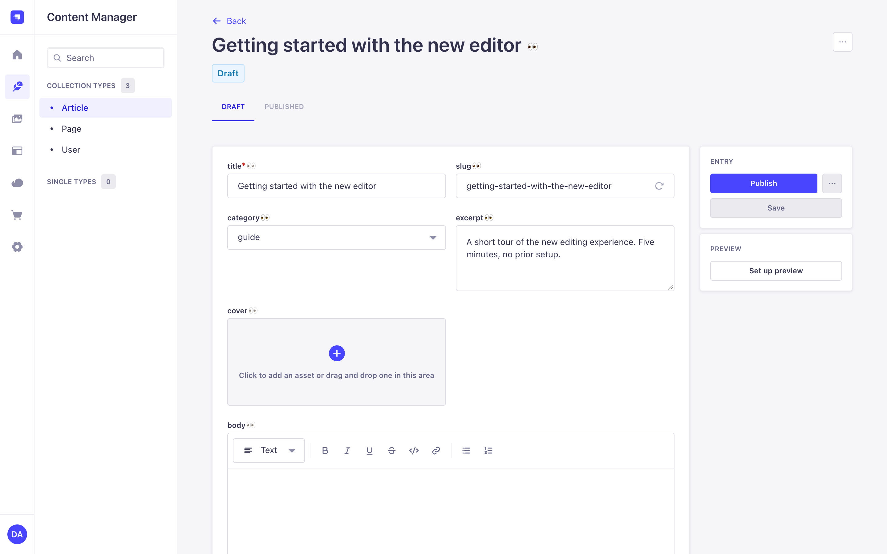
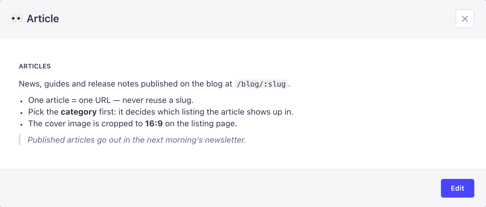
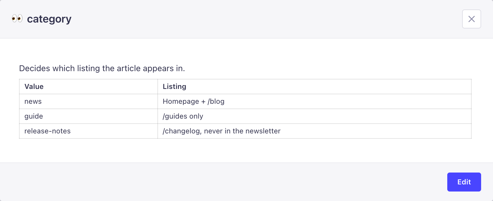
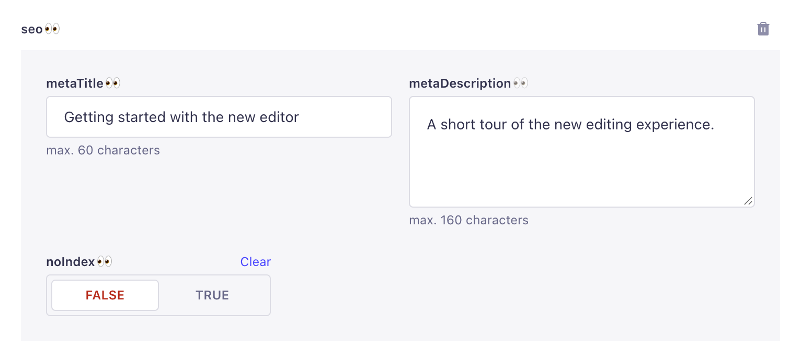
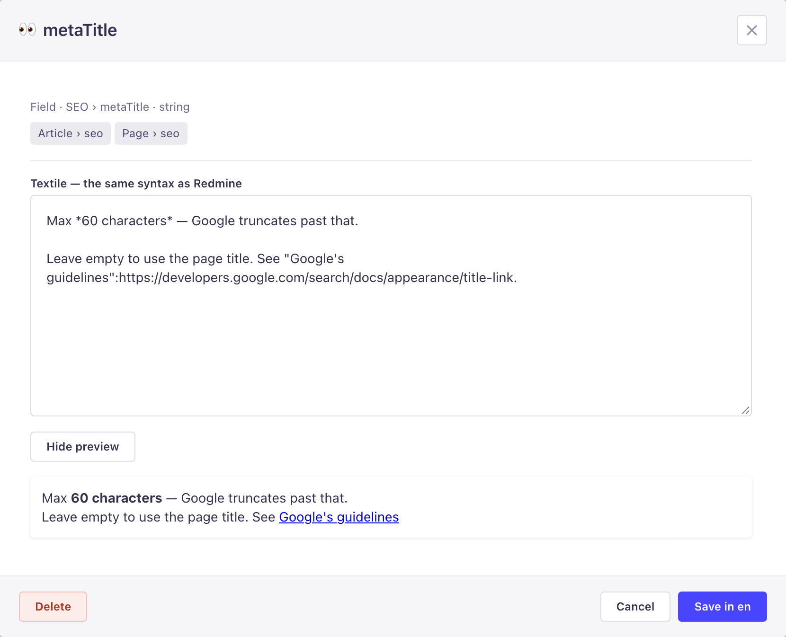
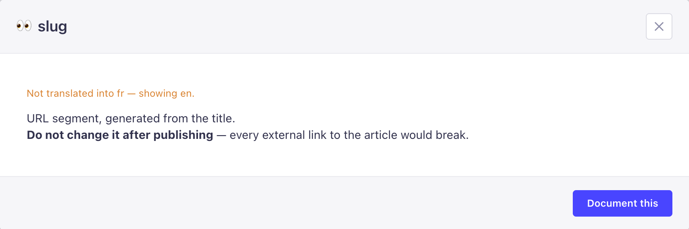
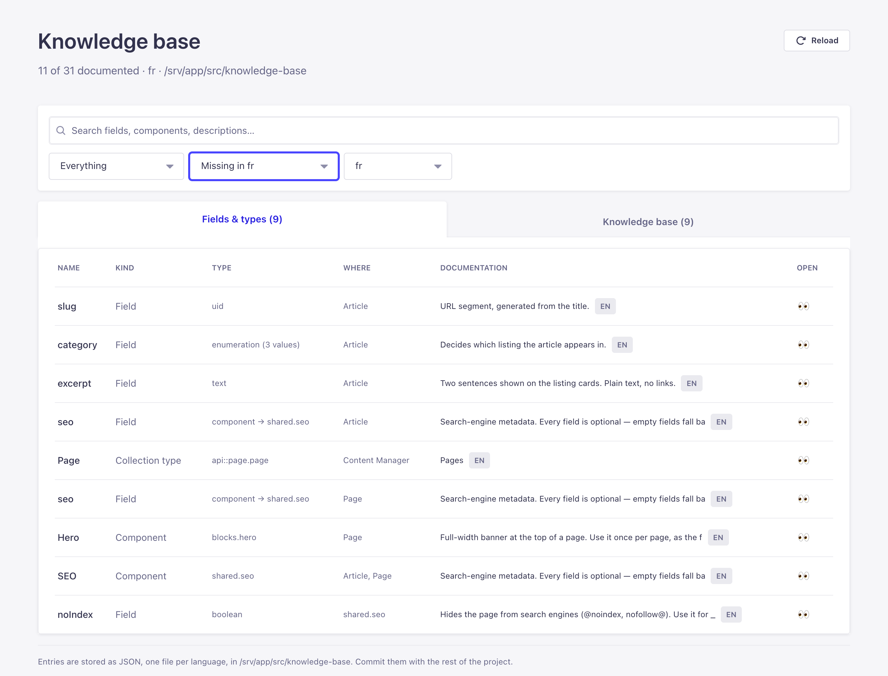
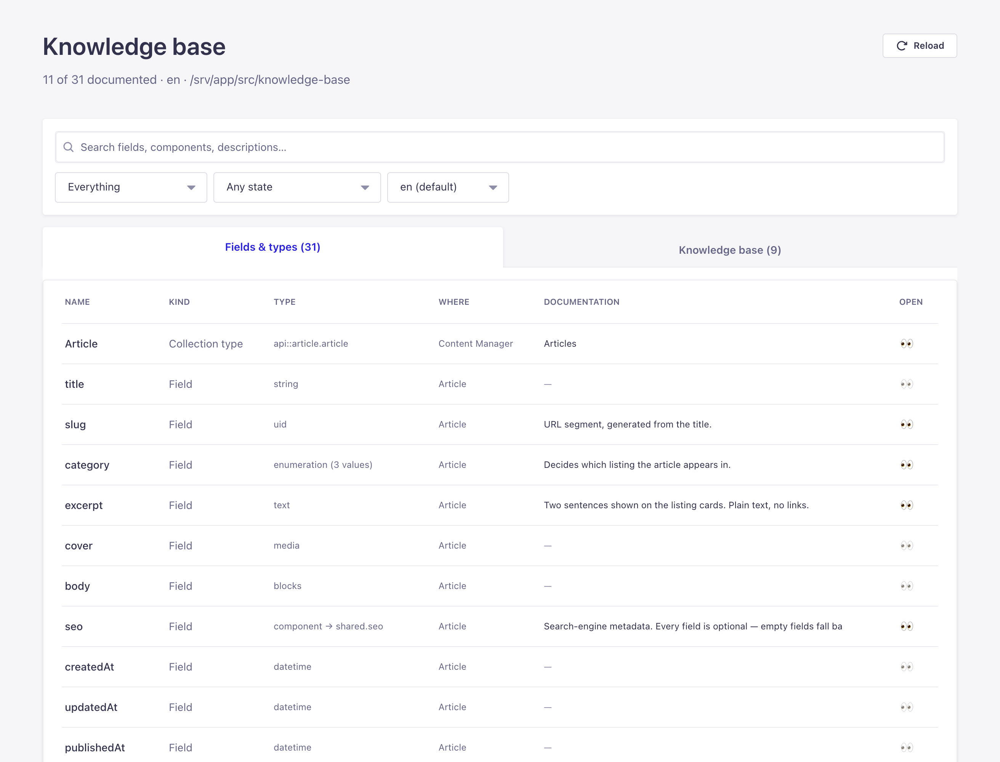
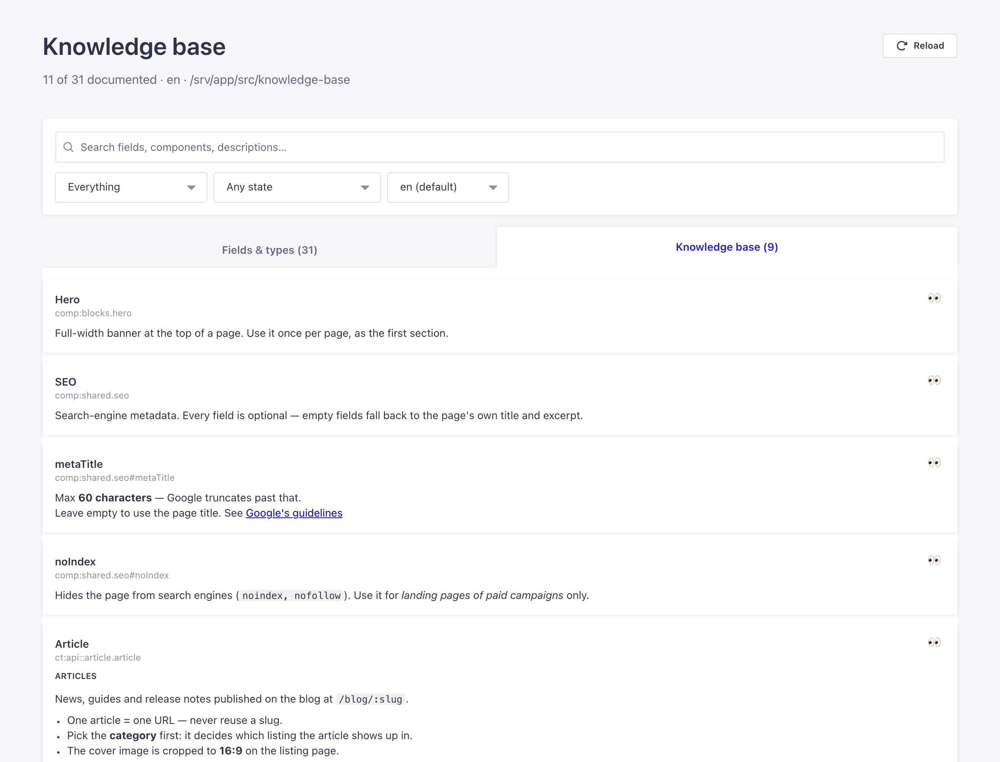

# strapi-plugin-knowledge-base

In-context documentation for the Strapi 5 admin.

A 👀 button sits next to every collection type title, every component and every
field in the Content Manager. Clicking it opens a modal with one thing: a
Textile description of what that node is, what belongs in it and where it is
used — plus the list of places it appears, read from the schema. If you have the
permission, you write that description without leaving the page.

The documentation is **not stored in your project's database**. It lives in
plain JSON files, one per admin language, so it is reviewable in a pull request
and follows the language each admin user picked for their interface.



## How it works

### Read

Press the 👀 next to the title to read about the content type, or the one next
to a label to read about that field. A button stays dimmed until its node is
documented, and hovering it shows the first line of the description.





### Components are documented once

Fields inside a component get their own buttons. The description belongs to the
component, so the same text shows up under every content type that embeds it.



### Write

With the *Edit documentation* permission, the modal turns into an editor. It
shows the node's type, the places it is used (read from the schema) and a
live Textile preview. **Save in en** writes `en.json`; saving an empty text
deletes the entry.



## Install

```bash
npm install strapi-plugin-knowledge-base
```

The plugin is enabled by default. To change where the files live, or to make an
environment read-only:

```js
// config/plugins.js
module.exports = {
  'knowledge-base': {
    enabled: true,
    config: {
      dataDir: 'src/knowledge-base', // relative to the app root, or absolute
      defaultLocale: 'en',           // fallback when an entry is not translated
      writable: true,                // false → viewer only (ephemeral filesystems)
    },
  },
};
```

## Permissions

Two admin permissions are registered and assignable in **Settings → Roles**:

| Permission | Effect |
| --- | --- |
| `Knowledge Base → Read documentation` | intended for roles that should reach the settings page |
| `Knowledge Base → Edit documentation` | required to save or delete an entry |

Reading is available to any authenticated admin user; writing is gated.

## Where the content lives

```
src/knowledge-base/
  en.json
  fr.json
  uk.json
```

```json
{
  "locale": "en",
  "updatedAt": "2026-09-22T10:00:00.000Z",
  "entries": {
    "ct:api::page.page": {
      "description": "Every editorial page of the storefront.\n\nRendered by the Next.js app at @/[locale]/[slug]@.",
      "updatedAt": "2026-09-22T10:00:00.000Z",
      "updatedBy": "someone@example.com"
    },
    "comp:shared.seo#metaTitle": { "description": "Max *60 characters* — Google truncates past that." }
  }
}
```

An entry is one Textile description; `updatedAt` and `updatedBy` are stamped by
the server. Saving an empty description deletes the entry.

### Textile — the same syntax as Redmine

Descriptions use Textile, so anything pasted from a Redmine wiki or ticket reads
the same here. The editor's **Preview** button renders the text as you type.
Supported syntax:

| Syntax | Renders as |
| --- | --- |
| `h1. Title` … `h6. Title` | headings |
| `*bold*` | bold |
| `_italic_` | italic |
| `+underline+` | underline |
| `-strike-` | struck through |
| `@code@` | inline code |
| `* item` (`**` nests) | bullet list |
| `# item` (`##` nests) | numbered list |
| `bq. note`, or a `>` prefix | quote |
| `"label":https://…` | link (`http(s):`, `mailto:` and `/`-relative only) |
| `\|_. head \|_. head \|` | table header row |
| `\| cell \| cell \|` | table row |
| `<pre> … </pre>` | code block |
| `---` | horizontal rule |

Word boundaries follow Textile's rules, so `snake_case_field` and
`well-known-value` stay literal instead of turning into emphasis. Anything else
— images, raw HTML, and Redmine's own macros such as `#123`, `[[Wiki page]]` or
`commit:abc` — is shown as plain text: they only mean something inside Redmine.

Nothing is turned into an HTML string at any point, so a description written by
one admin cannot inject markup into another admin's page.

Keys identify a **schema node**, never a document:

| Key | Documents |
| --- | --- |
| `ct:api::page.page` | a content type |
| `ct:api::page.page#slug` | one of its own fields |
| `comp:shared.seo` | a component, everywhere it is embedded |
| `comp:shared.seo#metaTitle` | a field of that component |

A component is documented once and the description shows up under every content
type that uses it — which is also how the "where is this used?" list in the
modal is built, straight from the schema.

Writing from the admin rewrites the whole file for that language, sorted and
pretty-printed, so the change lands as a readable diff. On a container with an
ephemeral filesystem, set `writable: false` and edit the files in the repo.

## Translations

Entries are per admin language. An admin using the French interface reads and
writes `fr.json`; when an entry has no French version yet, the modal shows the
`defaultLocale` text with a "not translated" notice and a one-click **Copy from
en** in the editor. The settings page can filter on exactly that: *missing in
this language*.





## Settings → Knowledge Base

- a full-width search across names, types, keys and descriptions;
- a grid of every content type, component and field, with what is documented and what is not;
- filters by kind and documentation state;
- a knowledge-base view listing every entry, rendered as Textile, flagging entries whose schema node no longer exists (`orphan`);
- a language switcher, so you can review another language's file without changing your own interface language.





## Notes on the 👀 buttons

The Content Manager only exposes a handful of injection zones, none of them next
to the title or a field, so the buttons are portalled into the page: one into
the `<h1>`, one after each form label. A label is matched to its field through
the control it points at (`label[for]` → the element's `name`), and the result
is resolved against the schema — anything that does not resolve gets no button
rather than a wrong one. Array indices are ignored (`items.2.title` documents
`title` of that component, not row 2). Inside a dynamic zone, a row whose path
could belong to more than one of its components is skipped.

Everything the plugin renders in the Content Manager sits behind an error
boundary: if the knowledge base breaks, the admin keeps working.

## Development

```bash
npm install
npm run build      # or: npm run watch:link
```

## License

MIT
